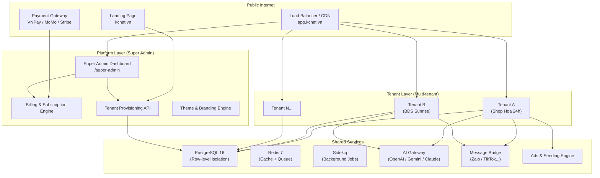
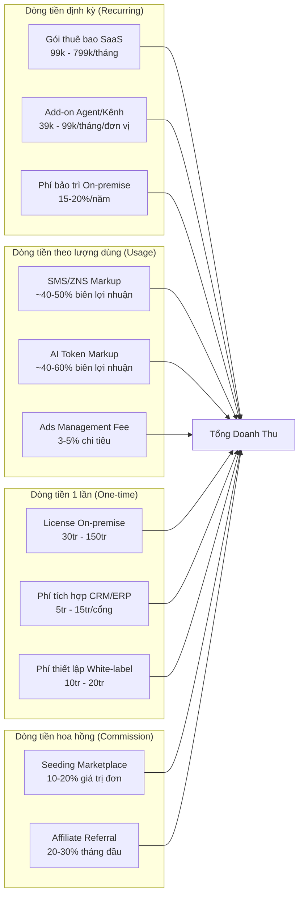

# KChat Platform — Bài Toán Tổng Thể & Kế Hoạch Kinh Doanh

> **Phiên bản:** 1.0 — 2026-10-01
> **Mục tiêu:** Xây dựng nền tảng SaaS đa kênh giao tiếp khách hàng phục vụ cá nhân kinh doanh (Seller) và doanh nghiệp, với kiến trúc Multi-tenant, White-label, AI Chatbot, Ads Campaign tích hợp và thanh toán trực tuyến.

> [!IMPORTANT]
> **Cập nhật 2026-11-17 (Kalo launch, ADR-017/018/019).** Tài liệu này là kế hoạch kinh doanh ban đầu (tên làm việc KChat, nay là **Kalo**). Phần lớn tính năng và mọi con số bên dưới là **kế hoạch / mục tiêu**, chưa phải sản phẩm đang bán. Bản Kalo launch thật sự có: hộp tin nhắn đa kênh (Chatwoot), Zalo cá nhân, Đơn hàng + POS nội bộ, mã VietQR cho đơn, gợi ý trả lời AI (cần khóa AgentGW), Báo cáo, Marketing (chiến dịch có sẵn của Chatwoot + ý tưởng nội dung), gói cước trả bằng chuyển khoản Casso (dùng thử 14 ngày), Console cho chủ nền tảng. **Chưa có:** tích hợp POS ngoài (KiotViet, Sapo, Nhanh.vn), vận chuyển GHN/GHTK, SMS Brandname, ZNS, quản lý Ads, tự thanh toán affiliate, pipeline video MMO, **giới hạn theo gói** (cơ chế `limits` của Chatwoot không có tác dụng; ADR-018/019). Bảng giá thực tế trên landing: 299.000đ / 699.000đ / 1.990.000đ mỗi tháng (khác bảng 4.1 bên dưới). Chi tiết trạng thái: [STATUS.md](STATUS.md).

---

## Mục lục

1. [Tổng Quan Sản Phẩm](#1-tổng-quan-sản-phẩm)
2. [Kiến Trúc Hệ Thống](#2-kiến-trúc-hệ-thống)
3. [Các Module Chức Năng](#3-các-module-chức-năng)
4. [Bảng Giá & Mô Hình Kiếm Tiền](#4-bảng-giá--mô-hình-kiếm-tiền)
5. [So Sánh Đối Thủ & Chiến Lược Giá](#5-so-sánh-đối-thủ--chiến-lược-giá)
6. [Lộ Trình Phát Triển (Roadmap)](#6-lộ-trình-phát-triển-roadmap)
7. [Lưu Ý Pháp Lý & Rủi Ro](#7-lưu-ý-pháp-lý--rủi-ro)

---

## 1. Tổng Quan Sản Phẩm

**KChat** là nền tảng **Quản lý Giao Tiếp Khách Hàng Đa Kênh (Omnichannel Customer Engagement Platform)** dành cho thị trường Việt Nam và Đông Nam Á.

### Tầm nhìn sản phẩm

> *"Một màn hình — mọi cuộc hội thoại — mọi kênh bán hàng — trợ lý AI riêng — thương hiệu riêng."*

### Đối tượng khách hàng mục tiêu

| Phân khúc | Mô tả | Quy mô ước tính |
|---|---|---|
| **Seller cá nhân** | Người bán hàng online trên Zalo, Facebook, TikTok, Shopee | 2-5 triệu người tại VN |
| **SME (Doanh nghiệp nhỏ)** | Shop có 3-20 nhân viên, chuỗi cửa hàng nhỏ | ~800.000 doanh nghiệp |
| **Mid-market** | Công ty 20-200 nhân viên (BĐS, Spa, Giáo dục, Tài chính) | ~50.000 doanh nghiệp |
| **Agency & Reseller** | Marketing Agency muốn White-label cho khách hàng của họ | ~10.000 đơn vị |

### Lợi thế cạnh tranh cốt lõi

1. **Giá rẻ hơn 30-50%** so với Pancake, Subiz, Haravan, Fchat
2. **Kết nối tin nhắn cá nhân** trên các nền tảng phổ biến chạy ngầm 24/7 trên server *(không cần mở máy tính/trình duyệt)*
3. **AI Chatbot riêng biệt** cho từng khách hàng, huấn luyện bằng dữ liệu riêng của họ
4. **White-label toàn diện** — Agency/Đối tác đổi tên, logo, domain, bán lại cho khách
5. **Open-source core** — Không bị vendor lock-in, chủ động kiểm soát công nghệ

---

## 2. Kiến Trúc Hệ Thống

### 2.1. Kiến trúc Multi-tenant



### 2.2. Phân tách vai trò (Role Hierarchy)

```
Super Admin (Chủ nền tảng KChat)
  ├── Quản lý toàn bộ Tenant (tạo, khóa, xóa, nâng/hạ gói)
  ├── Cấu hình gói cước, thanh toán, coupon
  ├── Quản lý tài nguyên AI (quota, API keys tổng)
  ├── Quản lý kênh tích hợp, message bridge pool
  ├── Báo cáo doanh thu, MRR, Churn toàn nền tảng
  └── Quản lý đối tác White-label, Affiliate

Tenant Admin (Chủ doanh nghiệp / Shop)
  ├── Quản trị hệ thống riêng (logo, màu sắc, domain)
  ├── Mua/gia hạn gói, mua add-on
  ├── Quản lý Agent (nhân viên), Team, phân quyền
  ├── Kết nối kênh (Zalo, FB, Website, SMS...)
  ├── Cấu hình AI Chatbot riêng (upload tài liệu, FAQ)
  ├── Chạy chiến dịch (Campaign, Seeding, Ads)
  └── Xem báo cáo, CSAT, hiệu suất nhân viên

Agent (Nhân viên trực chat)
  ├── Nhận & phản hồi hội thoại được phân công
  ├── Gắn nhãn, cập nhật CRM, ghi chú nội bộ
  ├── Sử dụng gợi ý AI, câu trả lời mẫu
  └── Không thể xem dữ liệu ngoài quyền hạn
```

---

## 3. Các Module Chức Năng

### Module 1: Super Admin Dashboard *(kế hoạch; hiện chỉ có Kalo Console: tổng quan, shop, giao dịch Casso)*

| Chức năng | Mô tả |
|---|---|
| **Quản lý Tenant** | CRUD tenant, bật/tắt/khóa, xem usage, impersonate (đăng nhập thay tenant để hỗ trợ kỹ thuật) |
| **Quản lý Gói cước** | Tạo/sửa/xóa gói (Starter, Growth, Enterprise, Custom), thiết lập giới hạn (số kênh, số agent, dung lượng, AI quota) |
| **Billing & Thanh toán** | Xem lịch sử thanh toán, hóa đơn, xử lý gia hạn thất bại, hoàn tiền, coupon/voucher |
| **Báo cáo kinh doanh** | MRR, ARR, Churn rate, LTV, số tenant theo gói, doanh thu theo tháng, conversion funnel từ landing page |
| **Quản lý AI Pool** | Phân bổ API key OpenAI/Gemini/Claude, theo dõi token usage từng tenant, thiết lập ngưỡng cảnh báo |
| **Quản lý Ads & Seeding** | Duyệt/reject chiến dịch seeding, quản lý đối tác API bên thứ ba, cấu hình markup % |
| **Cấu hình hệ thống** | SMTP, domain, SSL, Feature flags, rate limiting, bảo trì hệ thống |

### Module 2: Tenant Admin — Tùy biến thương hiệu (White-label) *(kế hoạch, chưa có)*

| Chức năng | Mô tả |
|---|---|
| **Logo & Favicon** | Upload logo riêng hiển thị trên thanh sidebar, trang login, email, widget chat |
| **Bảng màu (Color Theme)** | Chọn primary/secondary/accent color, hỗ trợ Dark Mode/Light Mode riêng từng tenant |
| **Tên miền riêng (Custom Domain)** | Tenant có thể trỏ `chat.tencongty.com` về hệ thống thay vì dùng `app.kchat.vn/tenantX` |
| **Email Branding** | Template email (xác nhận, thông báo, reset password) hiển thị tên & logo riêng |
| **Phân quyền nội dung** | Tenant Admin ẩn/hiện các module tùy gói (VD: Gói Starter không thấy mục Báo cáo nâng cao, Automation) |
| **Widget Chat Branding** | Thay đổi tiêu đề, lời chào, avatar, màu nền widget chat nhúng trên website |

### Module 3: AI Chatbot thông minh theo từng Tenant *(kế hoạch; hiện chỉ có gợi ý trả lời cho nhân viên)*

> [!IMPORTANT]
> Đây là tính năng tạo **khác biệt giá trị cốt lõi** so với đối thủ (Pancake, Fchat không có; Subiz/Haravan có nhưng rất cơ bản).

| Chức năng | Mô tả |
|---|---|
| **Knowledge Base riêng** | Mỗi tenant upload tài liệu riêng (PDF bảng giá, file Excel sản phẩm, FAQ nội bộ) → AI học từ dữ liệu đó |
| **AI Auto-reply** | Tự động trả lời khách hàng ngoài giờ làm việc hoặc khi hàng đợi quá đông dựa trên kiến thức riêng của tenant |
| **AI Copilot cho Agent** | Gợi ý câu trả lời cho nhân viên trực chat (agent đọc gợi ý → sửa lại nếu cần → bấm gửi), tiết kiệm 50-70% thời gian soạn tin |
| **AI Summarizer** | Tóm tắt hội thoại dài (50+ tin nhắn) thành 3-5 dòng để quản lý nắm bắt nhanh khi duyệt ca chat |
| **AI Sentiment** | Phân tích cảm xúc khách hàng (Tích cực / Trung lập / Tiêu cực) để cảnh báo các ca cần chú ý |
| **Multi-model** | Hỗ trợ OpenAI GPT-4o, Google Gemini, Anthropic Claude — Super Admin chọn model mặc định, tenant có thể đổi nếu gói cho phép |

**Cách tính phí AI:**
- Gói Starter: 500 AI messages/tháng (miễn phí)
- Gói Growth: 3.000 AI messages/tháng
- Gói Enterprise: 15.000 AI messages/tháng
- Mua thêm: 49.000đ / 1.000 AI messages

### Module 4: Thanh toán trực tuyến & Quản lý gói *(kế hoạch; hiện chỉ có chuyển khoản VietQR qua Casso, chưa có VNPay/MoMo/ZaloPay/Stripe, tự gia hạn, add-on)*

| Chức năng | Mô tả |
|---|---|
| **Cổng thanh toán** | Tích hợp **VNPay** (QR, ATM nội địa, Visa/Master), **MoMo**, **ZaloPay**, **Stripe** (cho khách quốc tế) |
| **Tự động cấp phát** | Khi thanh toán thành công → hệ thống tự tạo tenant mới, gửi email kích hoạt, sẵn sàng sử dụng trong 30 giây |
| **Gia hạn tự động** | Tự động gia hạn gói nếu khách bật Auto-renew; gửi email nhắc nhở 7 ngày + 3 ngày + 1 ngày trước khi hết hạn |
| **Mua thêm Add-on** | Khách mua lẻ: thêm kênh kết nối, thêm nhân viên, thêm gói AI, thêm dung lượng lưu trữ |
| **Nâng/hạ gói** | Cho phép nâng cấp giữa kỳ (tính phần chênh lệch pro-rata) hoặc hạ gói khi hết kỳ |
| **Hóa đơn & Lịch sử** | Xuất hóa đơn PDF, lịch sử giao dịch, xem trạng thái từng kỳ thanh toán |

### Module 5: Chiến dịch Quảng cáo & Seeding (Ads + Seeding Engine) — *kế hoạch, chưa có backend*

> [!NOTE]
> Module này tạo nguồn doanh thu bổ sung rất lớn (Usage-based revenue) ngoài phí thuê bao.

#### 5.1. Chiến dịch nội bộ (Built-in Campaigns)

> *Kế hoạch.* Hiện chỉ có chiến dịch sẵn của Chatwoot (Website Ongoing, SMS qua Twilio nếu tự cấu hình). SMS Brandname và ZNS **chưa có**.

| Loại | Mô tả |
|---|---|
| **SMS Campaign** | Gửi SMS hàng loạt qua cổng Twilio/nhà mạng VN. Tenant chọn nhãn khách hàng → soạn tin → hẹn giờ gửi |
| **Website Ongoing** | Popup live chat chủ động trên website theo điều kiện (thời gian trên trang, URL cụ thể) |
| **ZNS (Zalo Notification)** | Gửi thông báo ZNS chính thức qua Zalo OA (khi kênh Zalo OA được kích hoạt) |

#### 5.2. Tích hợp Ads Platform (Affiliate & API) — *kế hoạch, chưa có*

> Chưa có tích hợp Meta/TikTok/Shopee/Zalo Ads nào trong sản phẩm.

| Nền tảng | Cách tích hợp | Mô hình thu tiền |
|---|---|---|
| **Facebook Ads** | Tích hợp Meta Marketing API — Tenant liên kết tài khoản quảng cáo Facebook, xem báo cáo chiến dịch, tạo/tạm dừng ads ngay trong KChat | Phí quản lý 3-5% trên tổng chi tiêu ads, hoặc phí tính năng cố định/tháng |
| **TikTok Ads** | Tích hợp TikTok Marketing API — Quản lý chiến dịch TikTok Ads, theo dõi đơn hàng từ TikTok Shop | Tương tự Facebook |
| **Shopee Ads** | Tích hợp Shopee OpenAPI — Quản lý Shopee Ads (keyword, discovery ads) trong dashboard KChat | Phí cố định/tháng |
| **Zalo Ads** | Tích hợp ZMP API — Chạy quảng cáo ZNS, Zalo Ads trực tiếp | Markup 5-10% trên giá ZNS gốc |

#### 5.3. Seeding & Social Engagement — *kế hoạch, chưa có*

> [!WARNING]
> Seeding là dịch vụ nhạy cảm. KChat chỉ đóng vai trò **trung gian kết nối** với các đối tác cung cấp dịch vụ seeding tự nhiên, và **không trực tiếp cung cấp bot/tài khoản ảo**. Giao diện gọi là *"Tăng tương tác tự nhiên"* hoặc *"Hỗ trợ nội dung"*.

| Tính năng | Mô tả |
|---|---|
| **Marketplace đối tác** | Kết nối tenant với các Agency Seeding uy tín (nhân sự thật, tài khoản thật). Tenant đặt đơn → Đối tác nhận → Thực hiện → Báo cáo kết quả |
| **Content Seeding Builder** | Công cụ soạn kịch bản seeding: tạo bộ câu hỏi/bình luận mẫu, phân bổ thời gian đăng, phân nhóm tài khoản |
| **Báo cáo Engagement** | Dashboard theo dõi lượt tương tác thực (like, comment, share, lưu bài viết) trước và sau khi chạy seeding |
| **Affiliate Commission** | KChat thu hoa hồng 10-20% trên giá trị mỗi đơn seeding được đặt qua nền tảng |

### Module 6: Landing Page & Onboarding

| Chức năng | Mô tả |
|---|---|
| **Landing Page chính** | Trang `kchat.vn` giới thiệu sản phẩm, bảng giá, so sánh với đối thủ, nút "Dùng thử miễn phí" |
| **Trang đăng ký** | Nhập email + số điện thoại → chọn gói → thanh toán → hệ thống tự tạo tài khoản & hướng dẫn kết nối kênh |
| **Onboarding Wizard** | Hướng dẫn 4 bước sau đăng ký: (1) Đặt tên shop → (2) Kết nối kênh đầu tiên → (3) Mời nhân viên → (4) Gửi tin nhắn thử |
| **Blog/SEO** | Bài viết hướng dẫn, case study thành công, tips bán hàng → thu hút traffic organic từ Google |
| **Affiliate & Referral** | *(Kế hoạch, chưa có; không có chi trả tự động.)* Người giới thiệu nhận 20-30% hoa hồng tháng đầu tiên khi khách đăng ký gói trả phí qua link affiliate |

---

## 4. Bảng Giá & Mô Hình Kiếm Tiền

### 4.1. Gói thuê bao chính (SaaS Subscription) — *mục tiêu ban đầu, không phải bảng giá đang bán*

> Giá và giới hạn trong bảng là **mục tiêu**. Bản launch bán 3 gói 299.000đ / 699.000đ / 1.990.000đ và **chưa áp dụng giới hạn theo gói** (số agent, kênh, AI msg, tài liệu, rule…); các dòng giới hạn, Campaign SMS/ZNS, Ads Integration, Seeding, Custom Domain, Knowledge Base chỉ là kế hoạch.

> [!TIP]
> Chiến lược: Giá rẻ hơn 30-50% so với đối thủ trực tiếp, nhưng bù lại bằng doanh thu Add-on và Usage-based.

| | **Starter** | **Growth** | **Enterprise** | **White-Label** |
|---|---|---|---|---|
| **Đối tượng** | Seller cá nhân, hộ kinh doanh | Shop 3-15 nhân viên | Doanh nghiệp 15-50+ NV | Agency, Đối tác phần mềm |
| **Giá/tháng** | **99.000đ** | **299.000đ** | **799.000đ** | **Thỏa thuận** (từ 3tr/tháng) |
| **Giá/năm** (giảm 20%) | **950.000đ** (~79k/tháng) | **2.870.000đ** (~239k/tháng) | **7.670.000đ** (~639k/tháng) | Tùy quy mô |
| **Số Agent** | 2 | 5 | 15 (mua thêm được) | Không giới hạn |
| **Số kênh kết nối** | 2 kênh (VD: 1 Zalo + 1 Web) | 5 kênh | 15 kênh | Không giới hạn |
| **Tin nhắn cá nhân** | 1 tài khoản | 3 tài khoản | 10 tài khoản | Không giới hạn |
| **AI Chatbot** | 500 msg/tháng | 3.000 msg/tháng | 15.000 msg/tháng | Tùy chỉnh |
| **Knowledge Base AI** | ✗ | 5 tài liệu (max 10MB) | 50 tài liệu (max 100MB) | Không giới hạn |
| **Automation Rules** | 3 rules | 10 rules | Không giới hạn | Không giới hạn |
| **Custom Domain** | ✗ | ✗ | ✓ | ✓ |
| **Custom Branding** | Chỉ widget color | Logo + Color | Full branding | Full White-label |
| **Báo cáo** | Cơ bản | Nâng cao + CSAT | Nâng cao + Export | Toàn bộ + API |
| **Campaign (SMS/ZNS)** | ✗ | ✓ (trả phí theo tin) | ✓ | ✓ |
| **Ads Integration** | ✗ | Facebook Ads | Toàn bộ | Toàn bộ |
| **Seeding Marketplace** | ✗ | ✓ | ✓ | ✓ + Markup riêng |
| **Hỗ trợ** | Cộng đồng + Email | Email + Chat ưu tiên | Hotline + SLA 4h | Dedicated Account Manager |
| **Dùng thử** | **14 ngày miễn phí** | **14 ngày miễn phí** | **Demo riêng** | **POC 30 ngày** |

### 4.2. Add-on (Mua thêm lẻ) *(kế hoạch, chưa có)*

| Add-on | Giá/đơn vị/tháng |
|---|---|
| Thêm 1 Agent (nhân viên) | +39.000đ |
| Thêm 1 kênh kết nối | +49.000đ |
| Thêm 1 tài khoản tin nhắn cá nhân | +79.000đ |
| AI Messages (1.000 tin) | +49.000đ |
| Dung lượng lưu trữ (5GB) | +29.000đ |
| Custom Domain (tên miền riêng) | +99.000đ |

### 4.3. Doanh thu Usage-based (Phí theo lượng dùng) — *kế hoạch, chưa có*

> Biên lợi nhuận là mục tiêu ước tính. Hiện chưa bán SMS Brandname, ZNS, Ads fee; `ai_tokens_balance` được nạp qua Casso nhưng chưa bị trừ khi dùng AI.

| Nguồn thu | Cơ chế | Biên lợi nhuận ước tính |
|---|---|---|
| **SMS Brandname** | Mua sỉ từ nhà mạng (~300đ/tin) → Bán 500-600đ/tin | ~40-50% |
| **ZNS (Zalo Notification)** | Mua sỉ giá đại lý → Bán giá lẻ (+10-15%) | ~10-15% |
| **AI Token** | Mua OpenAI/Gemini giá gốc → Markup 40-60% bán cho tenant | ~40-60% |
| **Seeding Commission** | Hoa hồng từ đối tác Seeding Agency | ~10-20% giá trị đơn |
| **Ads Management Fee** | Phí quản lý % trên chi tiêu quảng cáo của tenant | ~3-5% chi tiêu |

### 4.4. Bán trọn gói On-premise (One-time License) *(kế hoạch, chưa có)*

| Gói | Giá trọn gói | Bao gồm |
|---|---|---|
| **Standard** | **30.000.000đ** | Cài đặt trên VPS/Cloud riêng, 10 agents, 5 kênh, AI cơ bản, 1 năm bảo hành |
| **Professional** | **55.000.000đ** | + Custom branding, 25 agents, 15 kênh, AI nâng cao, tích hợp CRM, 1 năm bảo hành |
| **Enterprise** | **80.000.000 - 150.000.000đ** | + White-label, không giới hạn agents/kênh, Ads integration, dedicated support, 2 năm bảo hành |
| **Phí bảo trì hàng năm (AMC)** | **15-20% giá trị hợp đồng** | Nâng cấp tính năng, hỗ trợ kỹ thuật, sao lưu, bảo mật |

---

## 5. So Sánh Đối Thủ & Chiến Lược Giá

### 5.1. Bảng so sánh giá với đối thủ — *cột KChat là mục tiêu, một số dòng chưa có thật*

> Các dòng Ads Integration, Seeding Marketplace, Custom Domain, thanh toán VNPay/MoMo/Stripe, huấn luyện AI riêng chưa có trong sản phẩm. Chưa dùng bảng này để quảng bá.

| Tính năng | **KChat (Starter)** | **Pancake** | **Fchat** | **Subiz** | **Haravan OmniChat** | **Sapo OmniAI** |
|---|---|---|---|---|---|---|
| **Giá khởi điểm/tháng** | **99.000đ** | ~200.000đ+ | 20.000đ/page + 20.000đ/NV | ~330.000đ+ | ~400.000đ+ | 249.000đ+ |
| **Kênh tin nhắn cá nhân** | ✓ (trên server 24/7) | ✗ | ✗ | Có (nhưng dùng extension) | ✗ | ✗ |
| **AI Chatbot riêng/tenant** | ✓ (huấn luyện dữ liệu riêng) | Botcake (cơ bản) | Chatbot kịch bản (không AI) | Có (gói cao cấp) | ✗ | AI cơ bản |
| **White-label** | ✓ (Full) | ✗ | ✗ | ✗ | ✗ | ✗ |
| **Custom Domain** | ✓ (từ gói Enterprise) | ✗ | ✗ | ✗ | ✗ | ✗ |
| **Ads Integration** | ✓ (FB, TikTok, Shopee, Zalo) | ✗ | ✗ | ✗ | Chỉ FB cơ bản | ✗ |
| **Seeding Marketplace** | ✓ | ✗ | ✗ | ✗ | ✗ | ✗ |
| **Thanh toán online tự động** | ✓ (VNPay, MoMo, Stripe) | ✓ | ✓ | ✓ | ✓ | ✓ |
| **API cho developer** | ✓ (Full REST + WebSocket) | Hạn chế | Hạn chế | ✓ | Hạn chế | Hạn chế |
| **Mã nguồn mở (Self-host)** | ✓ | ✗ | ✗ | ✗ | ✗ | ✗ |

### 5.2. Tại sao KChat rẻ hơn mà vẫn có lãi?

1. **Chi phí máy chủ thấp:** Kiến trúc Multi-tenant chia sẻ tài nguyên → chi phí trung bình 1 tenant chỉ ~5.000-15.000đ/tháng (so với giá bán 99.000đ+).
2. **Open-source core:** Không phải trả phí license nền tảng. Chatwoot OSS là miễn phí.
3. **Doanh thu bù đắp từ Usage-based:** SMS, AI Token, Seeding, Ads Fee tạo ra doanh thu bổ sung lớn ngoài phí thuê bao cố định.
4. **Quy mô theo số lượng:** Mô hình "giá rẻ, số lượng lớn" phù hợp thị trường Việt Nam.

---

## 6. Lộ Trình Phát Triển (Roadmap)

### Phase A — Nền tảng SaaS cơ bản (8-10 tuần)

| ID | Module | Kết quả |
|---|---|---|
| A-01 | **Super Admin Dashboard** | CRUD tenants, quản lý gói cước, feature flags, impersonate, báo cáo doanh thu cơ bản |
| A-02 | **Tenant Provisioning API** | API tự động tạo Account khi thanh toán thành công (Platform API `/platform/api/v1`) |
| A-03 | **Billing & Payment Gateway** | Tích hợp VNPay + MoMo, trang thanh toán, tự động cấp phát/gia hạn/khóa khi hết hạn |
| A-04 | **Plan & Quota Engine** | Giới hạn số agent, số inbox, AI messages, storage theo gói; kiểm tra quota realtime |
| A-05 | **Landing Page** | Trang `kchat.vn`: hero, tính năng, bảng giá, so sánh đối thủ, form đăng ký, CTA "Dùng thử 14 ngày" |
| A-06 | **Onboarding Wizard** | Hướng dẫn 4 bước sau đăng ký (đặt tên shop → kết nối kênh → mời NV → gửi tin thử) |

### Phase B — White-label & AI Chatbot (6-8 tuần)

> *Kế hoạch.* Thực tế đã có: gợi ý trả lời AI cho nhân viên (AgentGW). Chưa có Knowledge Base, AI auto-reply, tóm tắt/sentiment theo gói, feature gating theo gói (B-07), custom domain cho tenant.

| ID | Module | Kết quả |
|---|---|---|
| B-01 | **Tenant Branding Engine** | Upload logo, chọn bảng màu, custom email template, widget branding, custom login page |
| B-02 | **Custom Domain** | Hướng dẫn + tự động cấp SSL cho domain riêng tenant qua Let's Encrypt / Cloudflare |
| B-03 | **AI Knowledge Base** | Tenant upload PDF/TXT/Excel → vector embedding → lưu riêng biệt → chatbot trả lời dựa trên dữ liệu đó |
| B-04 | **AI Auto-reply** | Rule: ngoài giờ / hàng đợi > N → AI tự trả lời dựa knowledge base riêng |
| B-05 | **AI Copilot** | Gợi ý câu trả lời realtime cho Agent khi đang chat (agent duyệt rồi gửi) |
| B-06 | **AI Summarizer + Sentiment** | Tóm tắt hội thoại dài, phân tích cảm xúc khách hàng |
| B-07 | **Feature Gating per Plan** | Ẩn/hiện module trên giao diện theo gói cước (Starter không thấy Automation, Enterprise thấy hết) |

### Phase C — Ads, Seeding & Marketplace (6-8 tuần) — *chưa làm*

| ID | Module | Kết quả |
|---|---|---|
| C-01 | **Facebook Ads Integration** | Meta Marketing API: liên kết ad account, xem báo cáo chiến dịch, tạo/tạm dừng ads từ KChat |
| C-02 | **TikTok Ads Integration** | TikTok Marketing API: quản lý chiến dịch TikTok Ads |
| C-03 | **Seeding Marketplace** | Giao diện đặt đơn seeding, chọn đối tác Agency, theo dõi tiến độ, thanh toán qua ví nội bộ |
| C-04 | **Ads Dashboard** | Gộp báo cáo đa kênh (FB + TikTok + Shopee Ads) trên 1 dashboard thống nhất |
| C-05 | **Affiliate & Referral Program** | Hệ thống link giới thiệu, tính hoa hồng tự động, dashboard affiliate cho đối tác |
| C-06 | **ZNS & OA Campaign** | Tích hợp Zalo OA chính thức qua ZMP API, gửi ZNS có phí |

### Phase D — Tối ưu & Scale (Liên tục) — *chưa làm; D-03 (KiotViet, Sapo, Nhanh.vn) là kế hoạch, chưa có tích hợp*

| ID | Module | Kết quả |
|---|---|---|
| D-01 | **Blog/SEO Engine** | Blog tích hợp, bài viết chuẩn SEO, case study để thu hút traffic organic |
| D-02 | **Mobile App (React Native)** | App mobile cho Agent trực chat trên điện thoại |
| D-03 | **Marketplace Integration** | Kết nối KiotViet, Sapo POS, Nhanh.vn để xem tồn kho và tạo đơn hàng ngay trong chat |
| D-04 | **Advanced Analytics** | Cohort analysis, Customer journey mapping, Revenue attribution |
| D-05 | **Kubernetes & Auto-scaling** | Triển khai K8s production-ready, auto-scale theo traffic |

---

## 7. Lưu Ý Pháp Lý & Rủi Ro

### 7.1. Về kênh tin nhắn cá nhân

> [!CAUTION]
> Việc kết nối tự động vào tin nhắn cá nhân trên các nền tảng (Zalo, Facebook Messenger cá nhân) thông qua phương thức mô phỏng giao thức web **không được các nền tảng chính thức hỗ trợ** và có thể vi phạm Điều khoản Dịch vụ (ToS) của nền tảng gốc.

**Biện pháp xử lý khéo léo:**

1. **Trên Landing Page & Tài liệu Marketing:**
   - **KHÔNG** quảng cáo trực tiếp tính năng "kết nối Zalo cá nhân tự động" hoặc "hack Zalo".
   - Sử dụng ngôn ngữ trung tính: *"Hỗ trợ quản lý tin nhắn đa kênh"*, *"Kết nối các kênh giao tiếp phổ biến"*, *"Tích hợp linh hoạt với nhiều nền tảng nhắn tin"*.
   - Nhấn mạnh vào các kênh **chính thống**: Website Live Chat, Facebook Fanpage (qua API chính thức), Zalo OA (qua ZMP API), Email, SMS, TikTok, Telegram.

2. **Trong giao diện sản phẩm:**
   - Tính năng kết nối kênh cá nhân đặt ở mục *"Kênh nâng cao"* hoặc *"Tích hợp tùy chỉnh"*, kèm disclaimer:
     > *"Tính năng này sử dụng giao thức mở của nền tảng bên thứ ba. Người dùng tự chịu trách nhiệm tuân thủ điều khoản dịch vụ của nền tảng gốc. KChat không chịu trách nhiệm nếu tài khoản bị hạn chế bởi nền tảng gốc."*

3. **Ưu tiên kênh chính thống làm mặt tiền:**
   - Đẩy mạnh Zalo OA (Official Account) với ZNS (Zalo Notification Service) — đây là kênh hợp pháp 100%, có API chính thức.
   - Kênh cá nhân là **giá trị gia tăng riêng** (value add), không phải USP quảng cáo công khai.

4. **Pháp lý doanh nghiệp:**
   - Đăng ký doanh nghiệp với ngành nghề: *"Cung cấp dịch vụ phần mềm quản lý giao tiếp khách hàng"*.
   - Soạn **Điều khoản sử dụng (ToS)** và **Chính sách bảo mật (Privacy Policy)** rõ ràng, quy định trách nhiệm người dùng khi kết nối các kênh bên thứ ba.
   - Tuân thủ Luật An ninh mạng 2018 và Nghị định 13/2023/NĐ-CP về bảo vệ dữ liệu cá nhân — đặc biệt quan trọng khi xử lý tin nhắn cá nhân của người tiêu dùng.

### 7.2. Về dịch vụ Seeding

- KChat chỉ đóng vai trò **Marketplace kết nối** (giống Fiverr, Upwork), không trực tiếp cung cấp bot hay tài khoản ảo.
- Yêu cầu đối tác Seeding cam kết sử dụng tài khoản thật, nội dung tự nhiên, tuân thủ community guidelines của từng nền tảng.
- Trên giao diện gọi là *"Dịch vụ hỗ trợ nội dung & tương tác"* hoặc *"Content Engagement Services"*.

### 7.3. Về thanh toán và thuế

- Doanh nghiệp SaaS tại VN chịu thuế GTGT 10% (hoặc thuế TNDN nếu lợi nhuận > 0).
- Nếu có khách nước ngoài thanh toán qua Stripe: tuân thủ quy định xuất khẩu phần mềm (thuế suất GTGT 0%).
- Lưu ý: VNPay, MoMo đều yêu cầu doanh nghiệp có Giấy ĐKKD hợp lệ để đăng ký merchant.

---

## Tóm tắt các luồng kiếm tiền



> [!IMPORTANT]
> **Ước tính điểm hòa vốn (Break-even):**
> - Chi phí server (VPS 4 vCPU, 8GB RAM): ~1.500.000đ/tháng (phục vụ ~200 tenant)
> - Chi phí vận hành (domain, SSL, email, monitoring): ~500.000đ/tháng
> - **Chỉ cần 25-30 khách gói Starter hoặc 10 khách gói Growth là đã hòa vốn server.**
> - Từ khách thứ 31 trở đi, mỗi tenant mới gần như là lợi nhuận thuần (biên lợi nhuận >80%).
