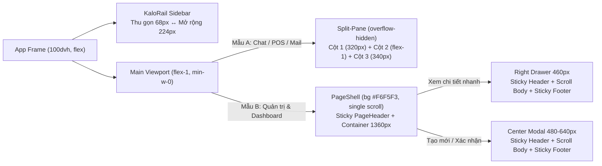

# Bản Thiết Kế Tổng Thể Kiến Trúc UI/UX Kalo v3 (Master Design Blueprint)

> **Trạng thái:** Bản thiết kế chờ chủ dự án xem và duyệt (CHƯA chỉnh sửa mã nguồn ứng dụng).
> **Ngày lập:** 2026-11-19
> **Phạm vi áp dụng:** Toàn bộ hệ sinh thái Kalo — **Kalo Shop App** (`/app/accounts/:id/*`), **Dashboard Tổng quan & Đo lường Chất lượng Đầu ra** (MỚI), **Kalo Console** (`/app/console/*`), **Super Admin** (`/super_admin`), và **Mail Inspector** (`/app/console/emails` bọc trên MailHog `:8025`).
> **Nguyên tắc bất biến:** Giữ trọn bộ nhận diện đã được đánh giá đẹp gồm **bộ icon nét đôi 2px Kalo** (`public/kalo-icons.svg`), **logo `#mark` chữ K cánh chim**, **màu thương hiệu Coral `#FF6B4A` / Action `#C93F24`** (Console Indigo `#231C40`), và **font `Be Vietnam Pro` + `tabular-nums`**. Chỉ tái cấu trúc **bề mặt nền, lưới bố cục, ô nhập liệu, nút bấm, khung thông tin, drawer/popup, cuộn trang, đóng/mở sidebar và thanh công cụ tiện ích**.

---

## Chương 1. Chẩn đoán Gốc rễ từ 7 Ảnh chụp Hiện trạng (Root-Cause Audit)

Qua đối chiếu trực quan 7 ảnh chụp màn hình thực tế với mã nguồn SCSS/Vue/ERB hiện tại, sự "rời rạc, thiếu thẩm mỹ, khó dùng" không đến từ màu sắc hay icon, mà đến từ **6 lỗi kiến trúc UI cốt lõi**:

| # | Màn hình hiện trạng | Biểu hiện quan sát được trên ảnh | Nguyên nhân gốc rễ trong mã nguồn |
|---|---|---|---|
| **1** | **Đơn hàng + Drawer `#1001`** (`OrderDrawer.vue`) | Thẻ & bảng trắng đặt trên nền trắng, không có viền/bóng tách lớp nên trôi phẳng lỳ; cạnh `#1001` có **hai viên pill giống hệt nhau `"Đã hủy" \| "Đã hủy"`**; thiếu khoảng thở, thiếu timeline, nút đóng là chữ trơn `"Đóng"`. | `OrdersIndex.vue` và `Dashboard.vue:147` đều đặt `bg-n-surface-1` (`#FFFFFF`), cộng `--border-weak: #F6EDE8` (`_ktech-theme.scss:61`) quá nhạt nên viền biến mất; `OrderDrawer.vue:62` thiếu `border-l` & `shadow-2xl`; dòng `70-80` in trùng trạng thái; **bug template ở `OrderDrawer.vue:154-165`** (`v-else` ghép sai vào `router-link v-if`) khiến dòng `"Đang tải mã QR…"` hiện cả khi QR đã tải xong. |
| **2** | **Chi tiết Khách hàng** (`ContactManageView.vue`) | Toàn bộ form co cụm lệch về giữa-trái; ô input xám bệt không viền; nút `Xoá liên hệ` đỏ hồng nổi bật bất cân xứng; cột phải 5 tab bị ép thành **`Thuộ... \| Lịch ... \| Ghi c... \| Tệp ... \| Gộp`**. | `ContactsDetailsLayout.vue:76-82` dùng `bg-n-surface-1`, `ltr:2xl:ml-56`, và `max-w-[40.625rem]` (`650px`) trôi giữa trang; `ContactManageView.vue:159` truyền class `[&>button]:w-full` cho `<TabBar>` trong cột phải `448px` làm 5 nút tự chia đều mỗi nút ~75px và bị `truncate` cắt cụt toàn bộ tiêu đề tiếng Việt! |
| **3** | **Popup Chỉnh sửa Chiến dịch** (`Modal.vue` / `Dialog.vue`) | Thanh cuộn nằm sát mép ngoài cùng của popup bo tròn, khi cuộn làm tiêu đề & nút `Huỷ / Xác nhận` bị trôi hoặc bị cắt mép; hai nút cuối bị kéo giãn 50/50 thô; input nền xám mờ. | `Modal.vue:79` đặt `overflow-auto` trên chính vỏ bọc `rounded-2xl` thay vì đặt vùng cuộn riêng ở phần thân (`body`); `_base.scss` / `Input.vue` dùng `bg-n-alpha-black2` (`rgba(31,23,20,0.04)`) không viền nổi rõ trên nền hộp thoại sáng. |
| **4** | **Trang Marketing** (`MarketingIndex.vue`) | Trên **cùng 1 trang** có tới 3 kiểu độ rộng lệch pha: hộp `Chiến dịch gửi tin hàng loạt` kéo tràn 100%, dòng `Tin nhắn SMS / WhatsApp` nằm trần sát lề trái, còn `Chiến dịch Live chat` lại tụt vào giữa ở chiều rộng hẹp. | `BroadcastCampaignsPanel.vue` chiếm `100%` bề ngang, trong khi `CampaignLayout.vue:26,52` (bên dưới) lại bọc `max-w-5xl mx-auto` (`1024px`) căn giữa và có `<header>` riêng lồng dưới header của `MarketingIndex`. |
| **5** | **Trang Cài đặt** (`SettingsHub.vue`) | Khối card tụt vào giữa màn hình trắng khổng lồ, hai bên trống trải; 6 nhóm trên chia 2 cột, riêng nhóm thứ 7 **"Báo cáo chi tiết"** có tới 7 mục bị đẩy lẻ loi xuống đáy cột trái tạo khoảng trống khổng lồ bên phải. | `SettingsHub.vue` đặt `max-w-5xl mx-auto` + `md:grid-cols-2` trên nền `#FFFFFF`, gộp nhầm 7 liên kết Báo cáo vào Cài đặt dù sidebar đã có phân hệ `Báo cáo`, và thiếu ô tìm kiếm cài đặt nhanh. |
| **6** | **Super Admin (`/super_admin`)** (`kalo.scss`) | Toàn bộ nền thiên hồng đào đơn điệu, **tất cả mọi chữ trong bảng (`2`, `Acme Org`, `en`, `1`, `5`, `Đang hoạt động`) đều bị nhuộm đỏ cam** như link lỗi! Thiếu thẻ thống kê nhanh đầu trang. | `app/views/super_admin/application/_collection.html.erb:65-72` bọc **mọi `<td>`** bằng `<a href="..." class="action-show">`, và `app/assets/stylesheets/administrate/kalo.scss:280` viết `.kalo-admin .kalo-table-scroll td a { color: var(--kalo-action-ink); }` (`#A3361D`)! |
| **7** | **Tin nhắn Đa kênh** (`ConversationView`) | **22 viên pill xám log hệ thống (`ACTIVITY`)** xếp nối đuôi chiếm kín 90% luồng chat, đẩy 2 tin nhắn thật của khách lên tuốt đỉnh; khung hội thoại, khung soạn thảo và cột phải dính vào nhau bằng viền quá nhạt; chữ `GHI CHÚ` bị cắt bởi vệt mờ cuối scroll; thiếu nút đóng/mở nhanh Sidebar & Panel trên thanh tiêu đề. | `MessageList.vue:203-229` render từng `MESSAGE_TYPES.ACTIVITY` thành 1 `<li>` độc lập không gom cụm; nền `--background-color: #FFF8F5` hòa cùng `--border-weak: #F6EDE8`; `SidepanelSwitch.vue` treo lơ lửng (`fixed/absolute`) thay vì nằm trong thanh công cụ đầu hội thoại; `KaloRail.vue` khóa cứng `w-[76px]` không cho mở rộng xem tên/số đầy đủ hay thu gọn tối đa. |

---

## Chương 2. Giải bài toán "Nền trắng hay Màu thương hiệu" — Hệ thống Bề mặt 3 Tầng (3-Tier Warm-Neutral Surface Architecture)

Để phần mềm nhìn **sang, sạch, dễ làm việc 8 tiếng/ngày mà vẫn đậm chất Kalo**, không dùng "nền trắng toàn tập" (phẳng lỳ, chói, card tàng hình) và cũng không dùng "nền hồng đào toàn tập" (nhợt nhạt, ám đỏ). Kalo v3 áp dụng **Quy tắc 80 / 15 / 5** với 3 tầng bề mặt tách biệt rõ độ sâu:

```
┌─────────────────────────────────────────────────────────────────────────┐
│ TẦNG 0 — APP CANVAS (Nền khung ứng dụng)         [80% Trung tính ấm]    │
│ Light: #F6F5F3 (Warm Alabaster) · Dark: #110F0E · Console: #F5F5FA     │
│                                                                         │
│   ┌─────────────────────────────────────────────────────────────────┐   │
│   │ TẦNG 1 — PRIMARY SURFACE (Thẻ, Bảng, Sidebar, Header, Form)     │   │
│   │ Light: #FFFFFF · Dark: #1B1816                                  │   │
│   │ Viền tách lớp: 1px solid #E6E0DC (Dark: #2E2825)                │   │
│   │ Đổ bóng thẻ: 0 1px 2px rgba(24, 19, 17, 0.04)                   │   │
│   │                                                                 │   │
│   │   ┌─────────────────────────────────────────────────────────┐   │   │
│   │   │ TẦNG 1.5 — SUB-SURFACE (Ô thông tin phụ, Thẻ lồng, Code)│   │   │
│   │   │ Light: #FAF8F6 · Dark: #231F1D                          │   │   │
│   │   └─────────────────────────────────────────────────────────┘   │   │
│   └─────────────────────────────────────────────────────────────────┘   │
│                                                                         │
│       ┌───────────────────────────────────────────────────────────┐     │
│       │ TẦNG 2 — OVERLAY (Drawer 460px, Modal, Command Menu)      │     │
│       │ Backdrop: rgba(20, 15, 13, 0.44) + blur(3px)              │     │
│       │ Surface: #FFFFFF (Dark: #211D1B) · Viền: #D8CFC9          │     │
│       │ Bóng: 0 24px 48px -12px rgba(24, 19, 17, 0.22)            │     │
│       └───────────────────────────────────────────────────────────┘     │
└─────────────────────────────────────────────────────────────────────────┘
```

### Bảng Token Chuẩn Kalo v3 (`_ktech-theme.scss` v3)

| Token vai trò | Light Mode (Shop & Super Admin) | Dark Mode (Shop & Super Admin) | Kalo Console (SaaS Admin) | Mục đích sử dụng |
|---|---|---|---|---|
| `--k-canvas` (`--background-color`) | `#F6F5F3` (`246 245 243`) | `#110F0E` (`17 15 14`) | `#F5F5FA` | Nền trang tổng thể (Canvas), giúp mọi thẻ trắng nổi bật tự nhiên |
| `--k-surface` (`--surface-1` / `--solid-1`) | `#FFFFFF` (`255 255 255`) | `#1B1816` (`27 24 22`) | `#FFFFFF` | Thẻ KPI, Bảng dữ liệu, Sidebar, Header trang, Khung nhập liệu |
| `--k-surface-sub` (`--solid-2`) | `#FAF8F6` (`250 248 246`) | `#231F1D` (`35 31 29`) | `#F9F9FC` | Header cột bảng `<thead>`, hàng hover nhẹ, hộp thông tin thêm |
| `--k-border-weak` | `#E6E0DC` (`230 224 220`) | `#2E2825` (`46 40 37`) | `#E4E3EE` | Viền thẻ, đường kẻ hàng bảng, ranh giới 3 cột Chat |
| `--k-border-strong` (`--k-input-border`) | `#D4C9C2` (`212 201 194`) | `#413834` (`65 56 52`) | `#CECDE0` | Viền ô Input, Select, nút Secondary Outline, tiêu đề nhóm |
| `--k-ink` (`--slate-12`) | `#181311` (`24 19 17`) | `#F5F2EF` (`245 242 239`) | `#19162B` | Tiêu đề, số liệu chính, nội dung bảng |
| `--k-muted` (`--slate-10`) | `#6B5F58` (`107 95 88`) | `#A69B95` (`166 155 149`) | `#625E7A` | Nhãn phụ, thời gian, placeholder mô tả |
| `--k-brand` (`--blue-9`) | `#C93F24` (Hover `#B0351D`) | `#FF6B4A` (Text trên nền `#110F0E`) | `#3B2F6B` (Sidebar `#231C40`) | Chỉ **5% diện tích**: CTA chính, trạng thái đang chọn, badge số |
| `--k-brand-soft` (`--blue-3`) | `#FFF0EB` | `#3A2019` | `#EEEBF9` | Nền mục đang chọn trên Sidebar, chip thương hiệu |
| `--k-bubble-me` (`--solid-blue`) | `#FFE8E0` (viền `#FAD4C7`) | `#45241B` | — | Bong bóng tin nhắn shop gửi đi (đủ tương phản 9.2:1 với `#181311`) |
| `--k-note-bg` / `--k-note-border` | `#FFFBEB` / `#FDE68A` | `#2B2312` / `#6B5118` | — | Khung **Ghi chú nội bộ** tách biệt hoàn toàn với **Trả lời khách** |
| **Semantic Status** | OK `#0E7C61`/`#E6F5EE` · Warn `#B45309`/`#FEF3DC` · Err `#B42318`/`#FEECEB` · Info `#1D4ED8`/`#EBF2FE` | Giữ đúng độ sáng tương phản $\ge 4.5:1$ | Giữ nguyên | Badge thanh toán, giao hàng, trạng thái shop, SLA |

> **Tại sao giải quyết dứt điểm cảm giác "lạc lõng"?**
> Khi nền ứng dụng là `#F6F5F3` còn thẻ, sidebar, header, và ô input là `#FFFFFF` có viền `1px solid #E6E0DC`, mắt người dùng lập tức nhận ra **ranh giới từng khu vực**, **không bị lóa trắng** cũng **không bị sến/bệt màu đào**.

---

## Chương 3. Chuẩn hóa Chữ viết, Ô Input, Select, Nút bấm & Bảng (Design Primitives)

### 3.1. Typography & Số học hiển thị
- **Font chính:** `'Be Vietnam Pro', system-ui, sans-serif` (`-webkit-font-smoothing: antialiased`).
- **Font số & mã:** Thêm `font-variant-numeric: tabular-nums` (và `JetBrains Mono` cho mã đơn `#1001`, mã vận đơn, `KALO123`, API key, log headers MailHog) để cột tiền và bảng số thẳng tắp theo hàng dọc.
- **Thang chữ 6 cấp chuẩn (cấm dùng chữ `< 11px`, trừ badge số `10px`):**
  - `Page Title (H1)`: `20px` / Bold `700` / tracking `-0.02em` (trong Sticky Header gọn gàng, thay thế H1 `28px` tốn diện tích).
  - `KPI Metric`: `24px–28px` / Extrabold `800` / `tabular-nums` / `line-height: 1.15`.
  - `Section Title (H2)`: `15px–16px` / Bold `700` / `#181311`.
  - `Card / Field Group Title (H3)`: `13px` / Semibold `600` (hoặc `11.5px` uppercase `tracking-wider text-[#6B5F58]` cho nhãn nhóm).
  - `Body & Control`: `14px` / Regular `400` / `line-height: 1.5` (tiếng Việt có dấu mũ + dấu nặng không bao giờ chạm nhau).
  - `Meta / Caption`: `12px` / Medium `500` / `#6B5F58`.

### 3.2. Ô Input, Select, Textarea — Hết hẳn tình trạng "xám chìm"
Thay toàn bộ `bg-n-alpha-black2` ở form nhập liệu bằng hệ thống **Crisp White Input**:
- **Bề mặt mặc định:** Nền `#FFFFFF`, viền `1px solid #D4C9C2`, bo góc `10px`, chiều cao chuẩn `40px` (`h-10`) cho form chính và `36px` (`h-9`) cho thanh tìm kiếm/lọc trên toolbar.
- **Trạng thái tương tác:**
  - Hover: viền đổi sang `#B8ACA4`.
  - Focus: viền đổi sang `#C93F24` + vòng sáng ngoài `0 0 0 3px rgba(201, 63, 36, 0.14)` (`outline: none`).
  - Readonly / Disabled: nền `#F3EFEA`, viền `#E6E0DC`, chữ `#6B5F58`, con trỏ `not-allowed`.
  - Error: viền `#B42318`, nền `#FFFBFA`, kèm dòng báo lỗi `12px` ngay dưới (không đẩy nhảy layout bằng khoảng trống dự phòng hợp lý).
- **Nhãn trường (Label Hierarchy):** Bắt buộc có khoảng cách `6px` (`mb-1.5`) với input, cỡ `13px` Semibold `#3D322D`, đánh dấu `*` đỏ cho trường bắt buộc, và ghi chú gợi ý (`helper text`) `12px` `#6B5F58` phía dưới.

### 3.3. Hệ thống 5 Cấp Nút Bấm (Button Hierarchy)
| Cấp nút | CSS Token / Bề mặt | Quy tắc dùng |
|---|---|---|
| **1. Primary Action** | Nền `#C93F24`, chữ `#FFFFFF` bold `600`, cao `38–40px`, bo `10px`, hover `#B0351D`, viền trong `inset 0 1px 0 rgba(255,255,255,0.16)` | Tối đa **1 nút Primary** trong mỗi khung nhìn (ví dụ: `+ Tạo đơn`, `Lưu thay đổi`, `Gửi mã QR`). |
| **2. Secondary Outline** | Nền `#FFFFFF`, viền `1px solid #D4C9C2`, chữ `#181311` `600`, hover nền `#FAF8F6` | Hành động phụ thường xuyên (`Mở POS`, `Xuất CSV`, `Huỷ`, `Chặn liên hệ`). |
| **3. Tonal Brand** | Nền `#FFF0EB`, chữ `#A3361D` `600`, hover `#FFE4DA` | Gợi ý AI (`✨ Chèn gợi ý`), gán nhãn nhanh, kích hoạt công cụ hỗ trợ. |
| **4. Ghost / Icon Utility** | Nền trong suốt, kích thước chuẩn `32x32` hoặc `36x36`, bo `8px`, hover nền `rgba(24,19,17,0.06)` + Tooltip phím tắt | Nút đóng/mở sidebar, mở drawer, sửa/sao chép trong hàng bảng. |
| **5. Danger (An toàn 2 bước)** | Trên trang: Nền `#FFFFFF` / `#FFFBFA`, viền `#F4C7C3`, chữ `#B42318` (KHÔNG đặt khối đỏ đặc chói chang dưới chân form như Ảnh 2!). Chỉ dùng nền đỏ đặc `#C92A2A` trong **Modal xác nhận xóa**. | `Xoá liên hệ`, `Hủy đơn hàng`, `Xóa chiến dịch`. |

---

## Chương 4. Kiến trúc Bố cục 2 Mẫu Chuẩn & Quy tắc Cuộn (Layout & Scroll Architecture)

Từ nay **mọi trang trong Kalo** chỉ đi theo đúng 1 trong 2 mẫu kiến trúc sau, triệt tiêu hoàn toàn việc trang thì `100%` sát mép, trang thì `max-w-5xl`, trang thì lệch `ml-56`:

### 4.1. Mẫu A — Không gian Tác nghiệp Toàn Màn hình (`Split-Pane 100dvh`)
Áp dụng cho: **Tin nhắn đa kênh**, **Kalo POS**, **Mail Inspector**.
- **Khung gốc:** `height: 100dvh; overflow: hidden;` (tuyệt đối không có thanh cuộn cấp trang `<body>` hay `<main>`).
- **Cấu trúc nội tại mỗi cột:** Mỗi cột là một `flex flex-col min-h-0 bg-white border-r border-[#E6E0DC]`:
  1. `Sticky Column Header` (`shrink-0`, cao cố định `56px`, `border-b`).
  2. `Scrollable Body` (`flex-1 min-h-0 overflow-y-auto`, thanh cuộn mảnh `6px` bo tròn `rgba(24,19,17,0.16)`, có `overscroll-behavior: contain` — **xóa sạch vệt gradient cắt chữ** ở panel phải như ở Ảnh 7).
  3. `Sticky Column Footer` (`shrink-0`, khung soạn tin hoặc nút `Thanh toán` POS).

### 4.2. Mẫu B — Trang Quản trị & Phân tích (`PageShell max-w-[1360px]`)
Áp dụng đồng nhất cho: **Tổng quan & Chất lượng**, **Đơn hàng**, **Khách hàng** (danh sách & chi tiết), **Marketing** (cả 5 tab!), **Báo cáo**, **Cài đặt**, **Kalo Console**, **Super Admin**.
- **Single Scroll Container:** Chỉ vùng nội dung của `<main>` cuộn; `<header>` trang dính đỉnh (`sticky top-0 z-20`).
- **Sticky PageHeader (`56px–64px`):** Nền `rgba(255,255,255,0.92)` + `backdrop-filter: blur(8px)` + `border-b border-[#E6E0DC]`.
  - **Cụm Trái:** Nút thu/mở Sidebar (trên mobile/nhỏ) + Breadcrumb / `H1 Title (20px)` + Phụ đề ngắn hoặc Tab điều hướng cấp 1 (viền dưới gạch chân hoặc segmented pill trắng sắc nét).
  - **Cụm Phải:** Thanh công cụ tiện ích (Tìm nhanh, Chọn khoảng ngày, Đổi thương hiệu) + **1 Primary CTA**.
- **Page Body Container:**
  - `max-w-[1360px] w-full mx-auto px-6 lg:px-8 py-6 flex flex-col gap-5` trên nền Canvas `#F6F5F3`.
  - Tất cả phần tử con (KPI row, Filter toolbar, Table card, Marketing panels, Settings grid) bắt buộc thẳng mép trái/phải **cùng 1 đường trục `1360px`**.



---

## Chương 5. Toán học Đóng/Mở Sidebar, Panel Phụ & Cụm Nút Tiện ích

### 5.1. Sidebar chính (`KaloRail`) — Cho phép Thu gọn & Mở rộng Linh hoạt (`⌘\`)
Thay vì khóa cứng `76px` như hiện nay (`KaloRail.vue:41`), `KaloRail` hỗ trợ **2 trạng thái mượt mà** (`transition: width 200ms cubic-bezier(.2,.8,.2,1)`), lưu vào `uiSettings` theo từng tài khoản:

| Thuộc tính | Trạng thái Thu gọn (`Rail Compact` — `68px`) | Trạng thái Mở rộng (`Rail Expanded` — `224px`) |
|---|---|---|
| **Khi nào mặc định** | Khi vào `POS`, hoặc viewport `< 1280px` | Trên màn hình quản trị rộng $\ge 1280\text{px}$ (người dùng có thể bấm thu gọn bất kỳ lúc nào) |
| **Đỉnh Sidebar** | Logo `#mark` `36px` + pill chữ viết tắt shop + nút mũi tên mở `→` | Logo + chữ **Kalo** + **Dropdown Đổi Shop** đầy đủ tên (`Acme Inc ▾`) + nút thu gọn `←` |
| **Nhóm điều hướng** | Icon nét đôi `22px` + nhãn nhỏ `10.5px` (hoặc tooltip tức thì khi hover) + badge số đỏ | Thanh ngang `h-10 px-3` gồm **Icon `20px` + Tên mục `14px` + Badge đếm số** căn phải, phân tách nhóm `VẬN HÀNH` (`Tổng quan`, `Tin nhắn`, `Đơn hàng`, `POS`, `Khách hàng`) và `TĂNG TRƯỞNG` (`Marketing`, `Báo cáo`) |
| **Chân Sidebar** | Icon Thông báo, Tìm kiếm (`⌘K`), Đổi giao diện Sáng/Tối, Avatar + chấm Online | Nút đầy đủ nhãn `Cài đặt`, `Thông báo (3)`, `Tìm nhanh ⌘K`, nút Sáng/Tối, thẻ Hồ sơ nhân viên + Trạng thái `Đang trực ▾` |

### 5.2. Toán học 3 Cột Màn hình Tin nhắn & Đóng/Mở Panel
Ở màn hình Desktop `1440px` (hoặc `1280px` khi Rail thu gọn `68px`):
- `Sidebar (68px hoặc 224px)` + `Danh sách hội thoại (312px)` + `Khung chat chính (flex-1, bảo đảm tối thiểu 460px)` + `Hồ sơ khách & Đơn nhanh (340px)`.
- **Nút đóng/mở trực quan ngay trên Thanh tiêu đề Hội thoại (`ConversationHeader`)** — **bỏ hẳn nút nổi `SidepanelSwitch` trôi giữa màn hình**:
  - Bên trái tên khách: nút `[◧]` (phím tắt `[`) bật/tắt `Danh sách hội thoại` khi cần tập trung xử lý đơn dài.
  - Bên phải nút `Xong`: nút `[◨ Hồ sơ]` (phím tắt `]`) bật/tắt cột phải `Hồ sơ khách hàng & Đơn`.
  - Khi chiều rộng khả dụng của cửa sổ `< 1120px`, cột `Hồ sơ khách hàng` tự động chuyển sang dạng **Overlay Drawer** đè nhẹ từ mép phải để khung chat không bao giờ bị bóp nghẹt.

### 5.3. Thanh Công cụ Tiện ích Toàn cục (Ergonomic Utility Strip)
- **`⌘K` Bảng lệnh nhanh (Command Bar):** Tìm tức thì tên khách, SĐT, mã đơn `#1001`, sản phẩm, hoặc nhảy sang trang cài đặt trong 2 lần bấm.
- **Nút `+ Nhanh` ở đầu mỗi phân hệ liên quan:** Tạo đơn ngay từ Chat (`OrderQuickModal`), Mở POS 1 chạm từ Đơn hàng, Gửi tin hàng loạt từ Phân tệp Khách hàng.
- **Khung soạn tin thông minh (`ReplyBox`):**
  - Tách biệt trực quan 2 chế độ: Tab **`Trả lời khách`** dùng nền `#FFFFFF` và nút gửi **`Gửi (⌘↵)`** màu Coral `#C93F24`; Tab **`Ghi chú nội bộ`** chuyển toàn bộ nền khung soạn sang vàng kem **`#FFFBEB` + viền `#FDE68A`** và nút **`Lưu ghi chú`** màu vàng hổ phách `#B45309`, loại bỏ 100% rủi ro nhân viên gửi nhầm ghi chú nội bộ ra cho khách!

---

## Chương 6. Khung Thông tin 3 Tầng, Drawer & Popup (Information Hierarchy & Overlay Spec)

Để giải quyết câu hỏi *"khung thông tin, thông tin thêm, thông tin chi tiết, drawer mở ra hay popup"*:

| Loại khung | Mục đích & Ví dụ | Quy chuẩn hình thức |
|---|---|---|
| **1. Khung thông tin chính** | Dữ liệu cốt lõi cần quét nhanh: Thẻ KPI, Bảng danh sách đơn/khách/shop, Form thông tin cơ bản | Thẻ `#FFFFFF`, `rounded-[14px]`, viền `1px solid #E6E0DC`, padding `20px` (KPI `16px–20px`). |
| **2. Khung thông tin thêm** | Metadata phụ trợ, ghi chú, nhãn gắn, thuộc tính UTM/nguồn, thuộc tính tùy chỉnh | Sub-card `#FAF8F6` viền `1px solid #EDE7E2`, `rounded-[12px]`, dùng **Accordion đóng/mở có số đếm ở tiêu đề** (vd: `Đơn gần đây (3) ▾`, `Ghi chú nội bộ (2) ▾`) để không dài lê thê. |
| **3. Khung thông tin chi tiết — Right Drawer (`460px`–`520px`)** | Dùng khi người dùng **cần xem/sửa chi tiết nhưng vẫn giữ nguyên danh sách nền phía sau**: Chi tiết Đơn hàng `#1001`, Tạo đơn nhanh từ Chat, Chi tiết Chiến dịch Broadcast, Đọc nội dung Email trong Mail Inspector | Trượt từ phải, `border-l border-[#D4C9C2]`, `shadow-2xl`, nền `#FFFFFF`, **bắt buộc chia 3 vùng cứng**: **(a) Sticky Header** (Mã/Tiêu đề + 1 badge trạng thái chính + nút Icon `×`), **(b) Scrollable Body** (`flex-1 overflow-y-auto p-5 space-y-4`), **(c) Sticky Footer** (`px-5 py-3.5 border-t bg-[#FAF8F6]` chứa CTA chính + nút phụ). |
| **4. Popup / Modal giữa màn (`480px` / `600px` / `720px`)** | Dùng cho **tác vụ tạo mới tập trung hoặc xác nhận hủy/xóa**: Tạo/Sửa chiến dịch Live chat, Tạo sản phẩm POS, Thêm tài khoản Shop, Xác nhận xóa liên hệ | Căn giữa màn hình trên backdrop mờ `rgba(20,15,13,0.45) blur(3px)`, `rounded-[16px]`, `max-h-[85dvh] flex flex-col overflow-hidden` — **bắt buộc 3 vùng cứng**: Header (`px-6 py-4 border-b`) → Body cuộn bên trong (`flex-1 overflow-y-auto px-6 py-5 space-y-4`) → Footer (`px-6 py-3.5 border-t bg-[#FAF8F6] flex justify-end gap-2.5` với nút kích thước gọn vừa chữ `Huỷ` + `Lưu chiến dịch`, **cấm kéo 50/50**). |

---

## Chương 7. Thiết kế Mới: Dashboard Tổng quan & Đo lường Chất lượng Đầu ra

Đáp ứng trực tiếp yêu cầu *"cần thiết có thể có các dashboard tổng quan để đo lường chất lượng sản phẩm đầu ra"*, Kalo v3 bổ sung **2 tầng Dashboard Tổng quan**:

### 7.1. Shop Overview & Output Quality Dashboard (Mục đầu tiên trên KaloRail — `Tổng quan`)
Giúp chủ shop & trưởng nhóm Marketing/CSKH mở app lên là thấy **chất lượng vận hành và chất lượng đầu ra thực tế**, không chỉ nhìn tổng doanh thu chung chung:

1. **Hàng 1 — 4 Thẻ KPI Chất lượng Đầu ra (Grid 4 cột đều nhau trong `1360px`):**
   - **Thẻ 1 · Doanh thu thực thu & Đơn hàng:** Tổng tiền đã thu (`tabular-nums`), số đơn hoàn tất, Giá trị đơn TB (`AOV`), so sánh `%` với kỳ trước.
   - **Thẻ 2 · Chất lượng Chuyển đổi Chat → Đơn:** Tỷ lệ hội thoại phát sinh đơn (`Chat-to-Order CVR %`), số đơn chờ QR chưa quét (link lọc thẳng sang Đơn hàng `Chờ thanh toán`).
   - **Thẻ 3 · Chất lượng Phục vụ CSKH (SLA):** Thời gian phản hồi đầu tiên trung bình (`FRT`), tỷ lệ đạt SLA `< 5 phút`, và badge cảnh báo **Số khách đang chờ phản hồi > 15 phút** (bấm nhảy thẳng vào hàng đợi Chat!).
   - **Thẻ 4 · Chất lượng Đầu ra AI & Nội dung Marketing:** Tỷ lệ nhân viên dùng gợi ý trả lời AI, số bình luận FB/IG đã tự động ẩn SĐT bảo vệ khách, và tỷ lệ kịch bản nội dung thương hiệu đã duyệt & lên lịch tuần này.
2. **Hàng 2 — Bảng Điểm Chất lượng 3 Trụ cột (Grid `7fr : 5fr`):**
   - **Trái · Chất lượng Sản phẩm & Đơn hàng:** Tỷ lệ giao/thanh toán thành công vs Tỷ lệ hoàn/hủy theo từng kênh (`Zalo`, `Facebook`, `Instagram`, `POS`), kèm bảng nhỏ **Sản phẩm cần chú ý** (hiển thị tỷ lệ hủy/lỗi theo SKU để chủ shop phát hiện sản phẩm có vấn đề chất lượng hoặc mô tả sai).
   - **Phải · Việc Cần Xử Lý Ngay (Actionable Queue):** Danh sách 4–5 đầu việc ưu tiên có nút xử lý 1 chạm (`Hội thoại chờ >15p`, `Đơn #1042 chờ đối soát QR >2h`, `Bình luận FB chứa SĐT cần nhắn riêng`).
3. **Hàng 3 — Chất lượng Đầu ra Theo Thương hiệu & Kênh:** Biểu đồ cột xếp ngang sạch sẽ đo 3 chỉ số: Tỷ lệ chốt đơn theo kênh, Hiệu quả các góc nội dung AI (Chuyên gia / Kể chuyện / Bằng chứng), và Điểm hài lòng khách sau chat (`CSAT`).

### 7.2. Kalo Console — Platform Health & Output Quality (`/app/console/overview`)
Dành cho đơn vị vận hành SaaS toàn hệ thống Kalo:
- **4 KPI Nền tảng:** Shop đang trả phí vs Dùng thử sắp hết hạn, Doanh thu gói qua Casso tháng này, Tỷ lệ đối soát tự động Casso không cần gán tay (`%`), và Sức khỏe hạ tầng (`Zalo Bridge / AI Gateway / Sidekiq`).
- **Bảng Shop Cần Chăm Sóc:** Lọc sẵn các shop dùng thử sắp hết hạn nhưng có hoạt động tạo đơn tốt (cơ hội chuyển đổi trả phí) hoặc shop có kết nối kênh Zalo/FB bị gián đoạn.

---

## Chương 8. Bản vẽ Tái cấu trúc Chi tiết Từng Màn hình (Tất cả 10 Phân hệ)

1. **`Tổng quan Chất lượng` (Mới):** Như Chương 7.1. Là trang mở đầu cho Quản lý / Chủ shop; Nhân viên trực chat vẫn có thể giữ mặc định vào `Tin nhắn`.
2. **`Tin nhắn đa kênh` (`ConversationView` + `ContactPanel`):**
   - **Gom nhóm Log Hệ thống (`KaloActivityGroup`):** Ở `MessageList.vue`, nếu có $\ge 2$ tin loại `MESSAGE_TYPES.ACTIVITY` đứng liên tiếp, gộp thành 1 viên pill gọn nhẹ căn giữa: **`⟳ 18 cập nhật hệ thống (đổi trạng thái, gắn nhãn, gán nhân viên) · Xem chi tiết ▾`**. Bấm vào mới bung danh sách thời gian chi tiết. Tin nhắn khách & tin nhắn shop hiện ngay lập tức ở trung tâm màn hình!
   - **Phân tách 3 cột sắc nét:** Nền luồng tin nhắn dùng `#F6F5F3` (giúp bong bóng trắng của khách và bong bóng `#FFE8E0` của shop nổi bật rõ rệt), danh sách hội thoại bên trái & hồ sơ khách bên phải nền `#FFFFFF` viền `1px solid #E6E0DC`.
   - **Header Hội thoại gọn & tiện:** Trái `[◧]` + Avatar + Tên + Kênh + Mã hội thoại; Phải nút `Xong` (kèm dropdown Trạng thái/Tạm dừng) + `[◨ Hồ sơ]` — **bỏ nút nổi lơ lửng**.
   - **ContactPanel cột phải (`340px`):** Tổ chức thành các khối thẻ nhỏ (`Hồ sơ liên hệ`, `Mua hàng & Đơn gần đây`, `Nguồn / Chiến dịch UTM`, `Nhãn`, `Ghi chú nội bộ`) với nút thu/mở từng khối và cuộn mượt không dính hiệu ứng cắt chữ ở chân panel.
3. **`Đơn hàng` (`OrdersIndex` + `OrderDrawer`) & `Kalo POS`:**
   - Dùng `PageShell max-w-[1360px]`. Header trang có `Đơn hàng`, nút phụ `Mở Kalo POS`, nút chính `+ Tạo đơn`.
   - Phía dưới Header có **Dải 4 Thẻ KPI Nhanh** (Tổng đơn hôm nay, Chờ thanh toán, Cần giao ngay, Doanh thu đã thu) + **Thanh Filter Tab có bộ đếm** (`Tất cả 24 · Chờ thanh toán 5 · Cần giao 8 · Đang giao 6 · Hoàn tất 4 · Đã hủy 1`) + ô tìm kiếm `36px` viền trắng sắc nét.
   - Bảng dữ liệu có dòng `52px`, hover mượt, cột tiền căn phải `tabular-nums`, cột trạng thái chia rõ 2 badge tách biệt `Thanh toán` và `Giao hàng` (riêng đơn đã hủy hợp nhất thành 1 badge xám-đỏ `Đã hủy`).
   - **`OrderDrawer` (`460px`) sửa triệt để 4 lỗi trong Ảnh 1:**
     - Sticky Header: `#1001 · 18:38 17/11` + Badge trạng thái (không trùng lặp chữ "Đã hủy") + Nút đóng `×` dạng icon `32x32`.
     - Body chia card rõ ràng: **(a) Tiến trình đơn 4 bước** (Tạo đơn → Đã thanh toán → Đang giao → Hoàn tất), **(b) Thông tin Khách & Địa chỉ**, **(c) Bảng Sản phẩm & Tổng kết tiền**, **(d) Thẻ QR VietQR / Đối soát thanh toán** (sửa lỗi `v-else` ở `OrderDrawer.vue:154-165` để tuyệt đối không bao giờ hiện `"Đang tải mã QR…"` khi QR đã hiển thị).
     - Sticky Footer: Nút CTA đổi trạng thái theo đúng ngữ cảnh (`Đánh dấu đã nhận tiền`, `Giao hàng`, `Hoàn tất đơn`) + nút phụ `Hủy đơn`.
   - **Kalo POS:** Dùng Mẫu A `Split-Pane 100dvh`, Sidebar mặc định thu gọn `68px` nhường chỗ cho lưới sản phẩm 3–4 cột & cột Giỏ hàng cố định `384px` bên phải.
4. **`Khách hàng` (`ContactsIndex` & `ContactManageView`):**
   - **Sửa triệt để Ảnh 2 (`ContactManageView`):** Bỏ `ltr:2xl:ml-56` và bỏ giới hạn `max-w-[650px]` trôi lửng lơ; chuyển sang **Lưới 2 Cột Cân Đối (`grid-cols-1 lg:grid-cols-[360px_1fr] gap-6`) trong `max-w-[1360px]`**:
     - **Cột Trái (`360px`) — Card Hồ sơ Tóm tắt:** Avatar lớn `64px`, Tên, Ngày tạo/Hoạt động, Tag/Nhãn (`+ Gắn nhãn`), Quick stats (`Số đơn`, `Tổng chi tiêu LTV`, `Kênh nguồn`), và 2 nút hành động nhanh (`Gửi tin nhắn`, `Chặn liên hệ`).
     - **Cột Phải (`flex-1`) — Không gian Chi tiết có Tabs đầy đủ chữ:** Bỏ `[&>button]:w-full`, thanh Tab dùng **`flex flex-wrap gap-1` với kích thước tự nhiên (`w-auto shrink-0 px-3.5 py-2`)** hiển thị nguyên vẹn từng chữ: **`Thông tin chi tiết` · `Thuộc tính tùy chỉnh` · `Lịch sử đơn & chat (3)` · `Ghi chú nội bộ (2)` · `Tệp đính kèm` · `Gộp liên hệ`**.
     - Bên trong tab `Thông tin chi tiết`: Form chia card trắng rõ ràng với ô input `#FFFFFF` viền `#D4C9C2`, nhóm `Liên kết mạng xã hội` gọn gàng, nút `Lưu thay đổi` căn phải rõ nét, và **`Vùng nguy hiểm (Danger Zone)`** tách xuống một card riêng ở cuối với nút outline đỏ nhẹ `#B42318` (tránh nút hồng rực chói mắt).
5. **`Marketing` (`MarketingIndex` — Đồng bộ 5 Tab):**
   - Dùng `PageShell max-w-[1360px]`. Header trang gồm Tiêu đề `Marketing` + 5 Tab kiểu segmented/underline gọn gàng (`Chiến dịch` · `Ý tưởng nội dung` · `Lịch nội dung` · `Bình luận FB/IG` · `Hồ sơ thương hiệu`).
   - Tab **`Chiến dịch`** hợp nhất thẳng hàng 100% trên trục `1360px`:
     - Nhóm 1: **Chiến dịch gửi tin hàng loạt (Zalo · FB · IG · Telegram)** (card trắng `#FFFFFF` có CTA `+ Gửi tin hàng loạt đa kênh`).
     - Nhóm 2: **Chiến dịch tự động theo Kênh** (dùng grid 2–3 cột cho `Live chat Website`, `SMS`, `WhatsApp` — biến 2 dòng text rời rạc `"Tin nhắn SMS  WhatsApp"` ở Ảnh 4 thành các thẻ/sub-tab sạch sẽ, đồng trục `1360px`!).
   - **`CampaignDialog` / `Modal.vue` (Sửa Ảnh 3):** Áp dụng chuẩn Modal 3 vùng: Sticky Header + Body cuộn bên trong (scrollbar lùi vào trong, không cắt góc bo) + Sticky Footer căn phải `[Huỷ]` + `[Lưu chiến dịch]`.
6. **`Báo cáo & Đa thương hiệu` (`ReportsIndex`):**
   - Dùng `PageShell max-w-[1360px]`. Đưa thanh **Bộ lọc Thời gian & Kênh + Đổi Thương hiệu (Multi-brand Bar)** lên vùng toolbar chuẩn dưới Header, và tích hợp thêm tab chuyển nhanh sang các báo cáo chi tiết (`Tổng quan` / `Hội thoại` / `Nhân viên` / `Nhãn` / `Kênh` / `CSAT`) thay vì giấu trong trang Cài đặt!
7. **`Cài đặt` (`SettingsHub`):**
   - Dùng `PageShell max-w-[1360px]`.
   - Thêm ô **`Tìm nhanh cài đặt…`** ngay bên phải Header `Cài đặt` (nhập "QR", "Zalo", "nhân viên" lọc tức thì các thẻ phù hợp).
   - **Tách 7 mục `"Báo cáo chi tiết"` ra khỏi trang Cài đặt** (chuyển về đúng phân hệ `Báo cáo`), giúp **6 nhóm Cài đặt còn lại** (`Kênh bán hàng`, `Nhân viên & Nhóm`, `Nhãn & Trả lời nhanh`, `Cửa hàng & Thanh toán`, `Tài khoản của tôi`, `Nâng cao & Tự động hóa`) xếp thành **Lưới Bento 3 Cột (`grid-cols-1 md:grid-cols-2 xl:grid-cols-3 gap-5`)** cân đối tuyệt đối 2 hàng × 3 cột trên nền `#F6F5F3`!
8. **`Kalo Console` (`/app/console/*`):**
   - Nâng cấp `ConsoleLayout.vue`: Sidebar `#231C40` hỗ trợ thu gọn (`68px ↔ 236px`), thêm nhóm mục **Kiểm tra Email (`Mail Inspector`)** ngay trong Console; nền nội dung `#F5F5FA`, bảng & card trắng viền `#E4E3EE`, nút `Back to App` và `Cập nhật gói` đồng bộ hoàn toàn với Input/Button v3.
9. **`Super Admin` (`/super_admin` — Sửa Ảnh 6):**
   - Giữ nền ấm trung tính `#F6F5F3` (bỏ nền hồng đào bệt), Sidebar tối `#1E1917` chữ sáng rõ ràng hoặc Sidebar trắng viền sắc nét tương thích Administrate.
   - **Sửa rule chết người `kalo.scss:280`:** Đổi `td a.action-show` sang màu chữ chính `--k-ink` (`#181311`), chỉ riêng cột tên/ID dùng chữ đậm `600` và hover chuyển `--k-brand` (`#C93F24`) gạch chân nhẹ.
   - **Thêm dải 4 Thẻ KPI Tóm tắt** ở đầu trang danh sách (`Tài khoản shop`, `Người dùng`, v.v.), cột Trạng thái dùng pill ngữ nghĩa (`Đang hoạt động` xanh ngọc `#0E7C61/#E6F5EE`, `Tạm khóa` đỏ nhạt), cột thao tác `Sửa` (nút outline nhỏ `h-7 px-2.5`) và `Xóa` (chữ đỏ `#B42318` chỉ xuất hiện khi cần).
10. **`MailHog / Hộp thư Kiểm thử Hệ thống` (`Mail Inspector` — `/app/console/emails`):**
    - Hiện tại dev chạy MailHog thô trên `:8025` có giao diện 2016 lệch tông hoàn toàn với Kalo (và cần đảm bảo `SMTP_ADDRESS=mailhog` trong dev để email từ Rails chạy đúng vào MailHog).
    - **Thiết kế giải pháp hợp nhất 2 lớp:**
      - **Lớp 1 (Native Kalo Mail Inspector tại `/app/console/emails`):** Xây dựng màn hình 2 cột (Mẫu A `Split-Pane`) trong Console gọi API `/api/v1/console/mail_inspector` (Rails proxy an toàn chỉ cho SuperAdmin đọc `:8025/api/v2/messages` ở dev/staging). Cột trái (`360px`): ô tìm kiếm người nhận/tiêu đề, lọc loại mail (`Xác thực`, `Đặt lại mật khẩu`, `Hóa đơn`, `Tất cả`), danh sách thư hiển thị rõ Người nhận, Tiêu đề, Thời gian, badge Chưa đọc. Cột phải: Header thông tin `From / To / Subject` + **Khung trích xuất nhanh Token / Link xác thực** (nút `Sao chép link` / `Mở link ngay`) + Tab `Xem HTML (Sandbox iframe)` · `Văn bản thuần` · `Raw Headers`.
      - **Lớp 2 (Nút mở nhanh):** Có nút `Mở trang MailHog gốc (:8025)` dự phòng, nhưng 99% thao tác test email hàng ngày thực hiện trực tiếp trong giao diện Kalo chỉnh chu!

---

## Chương 9. Lộ trình Triển khai Kỹ thuật An toàn (Chỉ chạy sau khi Chủ dự án Duyệt)

1. **Đợt 1 · Nền tảng Design System (0.5 ngày):** Cập nhật `_ktech-theme.scss`, `_base.scss`, `Input`, `Select`, `Button`, `Dialog.vue`, `Modal.vue` (3 vùng Header/Body/Footer), xây dựng `KaloPageShell.vue`, nâng cấp `KaloRail.vue` hỗ trợ `68px ↔ 224px` + lưu `uiSettings`.
2. **Đợt 2 · Tin nhắn & Khách hàng (1 ngày):** Xây `KaloActivityGroup.vue` gom cụm log hệ thống trong `MessageList.vue`, thêm nút `[◧]` / `[◨]` trên `ConversationHeader`, chỉnh `ContactPanel` tách card + sửa cuộn, tái cấu trúc `ContactManageView` + `ContactsDetailsLayout` sang 2 cột cân đối `360px + 1fr` hết cắt chữ TabBar.
3. **Đợt 3 · Đơn hàng, Marketing & Cài đặt (1 ngày):** Sửa `OrderDrawer` (hết trùng chip `"Đã hủy"`, sửa lỗi `v-else` QR, thêm Timeline 4 bước & 3 vùng Header/Body/Footer), thêm dải 4 KPI `OrdersIndex`, đồng bộ `MarketingIndex` + `CampaignLayout` về lưới `1360px`, chuyển `SettingsHub` thành Bento 3 cột + ô tìm kiếm nhanh.
4. **Đợt 4 · Dashboard Tổng quan & Đo lường Chất lượng Đầu ra (1 ngày):** Xây dựng API `/api/v1/accounts/:id/kchat/overview_quality` (tính SLA FRT, chat chờ `>15m`, tỷ lệ chốt đơn từ chat, tỷ lệ dùng gợi ý AI, chất lượng đơn & hoàn/hủy theo SKU/kênh) + giao diện `OverviewIndex.vue` đứng đầu `KaloRail`.
5. **Đợt 5 · Console, Super Admin & Mail Inspector (1 ngày):** Sửa `kalo.scss` + `_collection.html.erb` ở `/super_admin` (dứt điểm lỗi chữ đỏ cả bảng + thêm KPI), nâng cấp `ConsoleLayout` + `ConsoleOverview` + `ConsoleMailInspector` (`/app/console/emails` bọc MailHog API `:8025`), đồng bộ `SMTP_ADDRESS=mailhog` cho môi trường dev.
6. **Kiểm chứng Tổng thể Sau Triển khai:** Chạy đầy đủ RSpec, Vitest, RuboCop, ESLint, `check_contrast.mjs` (cả Light & Dark mode), `vite build`, và kiểm tra trực tiếp mọi màn hình trên `http://localhost:3005` + `/super_admin` + `/app/console/emails`.

---

## Chương 10. Các Quyết định cần Chủ dự án Xem xét & Chốt trước khi Thực thi

1. **Tầng nền & Tỷ lệ màu:** Đồng ý chuyển từ nền trắng/đào phẳng sang **Canvas `#F6F5F3` + Thẻ `#FFFFFF` viền `#E6E0DC` + 5% Coral `#C93F24`** như mô tả ở Chương 2?
2. **Mục đầu tiên trên Sidebar:** Có thêm trang **`Tổng quan` (Dashboard Chất lượng Đầu ra)** làm mục trên cùng của `KaloRail` hay giữ `Tin nhắn` ở trên cùng và đặt `Tổng quan Chất lượng` làm tab mặc định của `Báo cáo`? (Bản thiết kế khuyến nghị đặt `Tổng quan` lên đầu để Chủ shop & Marketer có cái nhìn tổng thể ngay khi đăng nhập).
3. **Trang `Cài đặt`:** Đồng ý chuyển nhóm 7 mục `Báo cáo chi tiết` ra khỏi `SettingsHub` về phân hệ `Báo cáo` để `Cài đặt` cân đối đẹp theo lưới Bento 3 cột?
4. **Trang `MailHog`:** Đồng ý tích hợp **`Mail Inspector` giao diện Kalo tại `/app/console/emails`** (gọi API MailHog `:8025` trong dev/staging và cấu hình `SMTP_ADDRESS=mailhog` cho dev) để không phải chuyển sang giao diện MailHog thô?
